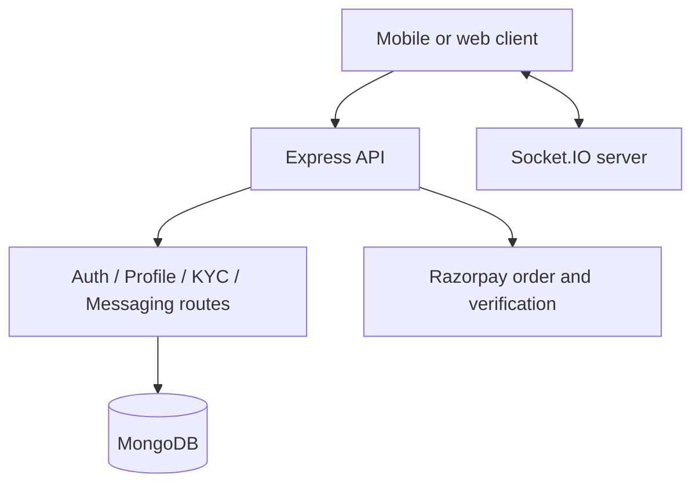

# HiMate — Social & Real-Time Communication Backend

> **Status:** In development. This repository contains backend code for a social connection application. It is not presented as a production-ready or fully launched service.

## Overview

HiMate is a Node.js and Express backend exploring authentication, profiles, messaging, identity verification, real-time connections, and payment integrations.

## Current API surface

The application entry point (`index.js`) mounts these routes:

| Base path | Purpose |
| --- | --- |
| `/api/auth` | Authentication |
| `/api/language` | Language preferences |
| `/api/profile` | Profile management |
| `/api/voice-test` | Voice-related endpoints |
| `/api/kyc` | Verification workflows |
| `/api/messages` | Messaging |

Additional entry-point functionality:

- Socket.IO server initialization and connection/disconnection listeners
- `POST /create-order` for Razorpay order creation
- `POST /verify` for Razorpay payment signature verification

These are source-observed routes and integrations; the completeness of individual workflows still requires testing.

## Technology stack

- **Backend:** Node.js, Express 4
- **Database:** MongoDB, Mongoose
- **Real-time:** Socket.IO
- **Payments:** Razorpay
- **Dependencies for additional workflows:** Redis, Twilio, Multer, Argon2, Axios

## Architecture



## Local setup

**Requirements:** Node.js, npm, MongoDB configuration, and credentials for any third-party services being exercised.

```bash
git clone https://github.com/Muhammedsajid10/HiMate.git
cd HiMate
npm install
```

Create a local `.env` file for the configuration expected by the app. The entry point references `PORT` (default `5000`), `RAZORPAY_KEY_ID`, and `RAZORPAY_SECRET`. Database configuration is loaded by `config/db`.

```bash
npm start
```

The current `start` script launches `nodemon index.js`. The package's test script is a placeholder and does not run automated tests.

## Engineering focus

- REST API organization using Express route modules
- MongoDB-backed application development
- Socket.IO integration for real-time connectivity
- Razorpay order creation and signature verification
- Backend integration with authentication, profiles, and verification workflows

## Work in progress

- Verify the completeness of chat, audio/video, and coin-based features before advertising them as implemented
- Add automated tests and API documentation
- Review authentication, authorization, validation, and rate limits for all endpoints
- Restrict Socket.IO CORS origins for production use
- Secure payment endpoints and test failure/replay scenarios
- Add a sanitized environment-variable example

## Portfolio note

HiMate is a backend engineering project in progress. The code and this documentation should not be taken as evidence of a launched production platform.
